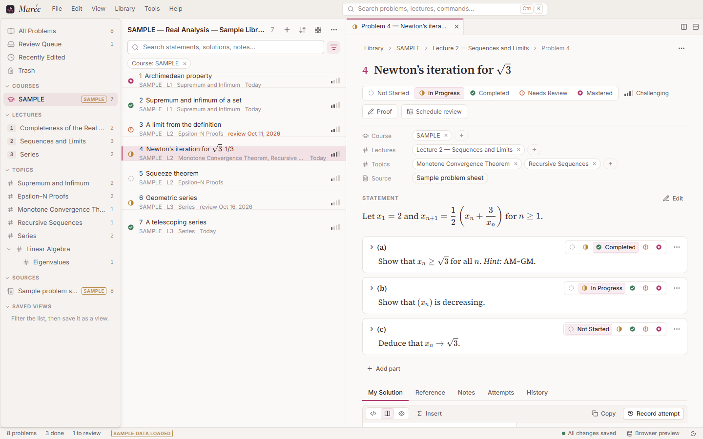

# Marée

*A personal sea of mathematical problems.*

Marée is a local-first Windows desktop application for collecting, organising and solving
mathematical exercises — from lectures, textbooks, assignments and PDFs — with careful
LaTeX typesetting throughout. It is a quiet workbench rather than a learning game: courses,
lectures, topics and sources are independent ways into one library, every problem keeps
its provenance, and your proofs, attempts and notes stay on your own computer.



## Highlights

* **Four independent dimensions** — Course, Lecture, Topic (hierarchical) and Source.
  A problem can belong to several lectures and carry several topics.
* **Mathematics first** — LaTeX-flavoured Markdown everywhere (statements, solutions,
  notes, previews, search results): `\( … \)`, `$ … $`, `\[ … \]`, `align*`, `cases`,
  matrices, theorem/lemma/proof environments, LaTeX lists, user macros. Rendered by
  KaTeX, stored verbatim — formulas are never turned into images.
* **Proof workspace** — split source/preview editor (CodeMirror 6) with LaTeX highlighting,
  command completion and snippets; *My Solution*, a hidden-by-default *Reference
  Solution*, *Notes*, recorded *Attempts* (immutable snapshots with outcomes) and a
  per-problem *History*. Multi-part problems (a), (b), (c) have independent status and
  solutions. Everything autosaves.
* **Import** — PDF, Markdown, LaTeX, plain text, Word (.docx, including equations),
  JSON and images, singly or in batches, by dialog or drag-and-drop. Problem boundaries,
  numbers, sub-parts and lecture headings are detected; course, lectures, topics and
  problem type are suggested; duplicates and previously imported files are recognised;
  every problem is reviewed beside its source page before saving.
* **Honest PDF handling** — PDF text loses mathematical structure. Marée keeps the raw
  extracted text as provenance, flags uncertain problems, shows the source page next to
  the editor and offers an opt-in *assisted LaTeX conversion* (scripts, fractions,
  symbols) that must be checked. Scanned PDFs are recognised; there is no pretend OCR.
* **Find anything** — full-text search over titles, statements, solutions, notes, topics
  and source metadata; combinable filters (topics with *any/all*, lectures, status,
  difficulty, type, source, review state…) saved as reusable views; a command palette.
* **Review without pressure** — a review queue (due dates, *Needs Review*, incorrect or
  incomplete attempts, in-progress work) and a restrained progress overview by course,
  lecture and topic. No streaks, badges or confetti.
* **Your data** — SQLite in your profile folder, daily automatic snapshots, full backups
  (JSON + database copy + original files in one zip), exports to Markdown, LaTeX, JSON and
  PDF (via the print dialog). Documented formats in [docs/SCHEMA.md](docs/SCHEMA.md).
* **A calm interface** — custom title bar with a real menu bar (File · Edit · View ·
  Library · Tools · Help), tabs and split editors, resizable panes, keyboard-driven
  navigation, and four themes: Marée (light), Dark Academic, Waterloo Math Pink and
  Black & Gold. English UI; French and Chinese dictionaries are started.

## Install (Windows 10/11)

The installers are in the `release/` folder (a fresh build writes them to
`src-tauri/target/release/bundle/`):

* `Marée_1.0.0_x64-setup.exe` — per-user installer, no administrator rights needed
  (recommended; tested: install, full acceptance run, clean uninstall)
* `Marée_1.0.0_x64_en-US.msi` — MSI package for managed, per-machine installs (built, not install-tested)
* `maree-portable.exe` — the bare executable, for portable use (see below)

Marée uses Microsoft Edge WebView2, which is part of Windows 11 and current Windows 10;
the installer downloads it if missing. The installers are not code-signed, so Windows
SmartScreen may ask for confirmation ("More info › Run anyway").

**Portable use:** copy `maree.exe` anywhere and create an empty file called `portable`
next to it; the library is then kept in a `MareeData` folder beside the executable.

## Getting started

1. On first launch the *Welcome* tab walks through five short steps: create a course
   (e.g. *MATH 147 — Advanced Calculus*), add lectures (*7–12*), add topics
   (*MCT, Subsequences, Cauchy Sequences*), import a document, and open a problem.
   *Load a small sample library* shows a populated library; it is clearly marked and
   removable (*Library › Remove Sample Data*).
2. **Import** with `Ctrl+O` or by dropping files on the window. Check the suggested course
   and lecture mapping, step through the problems (`Alt+↓`), correct the LaTeX beside the
   source page, and import.
3. **Work** on a problem: write in *My Solution* (`Ctrl+M` wraps inline math), set the
   status with one click or `Alt+1…5`, schedule a review, record an attempt when you are
   done.
4. **Find** with `Ctrl+F` (library search), the filter button, or `Ctrl+K` (everything,
   including commands). Save useful filters as views.
5. **Back up** with `Ctrl+Shift+S`. Export a lecture or topic from its context menu.

Press `F1` inside the app for all keyboard shortcuts and a LaTeX syntax reference.

## Where your data lives

| | |
|---|---|
| Library database | `%APPDATA%\com.maree.library\maree.db` |
| Original documents and attachments | `%APPDATA%\com.maree.library\files\` |
| Automatic snapshots (last 10) | `%APPDATA%\com.maree.library\backups\` |

*Tools › Open Data Folder* opens it. Uninstalling Marée does not delete your library.

## Building from source

Requirements: Node.js ≥ 22, Rust (stable, MSVC toolchain), Visual Studio Build Tools
with the C++ workload, WebView2 runtime.

Build on a local NTFS disk. A Google Drive / OneDrive virtual drive is a poor place for
`node_modules` and Rust build output (tens of thousands of files, no junctions). The full
history is included as `maree-git-history.bundle`:

```bash
git clone maree-git-history.bundle C:\dev\maree
cd C:\dev\maree
npm install
npm run tauri:dev      # run the desktop app with hot reload
npm run tauri:build    # release build + NSIS and MSI installers
```

`npm run dev` serves the interface in a regular browser (useful for UI work); it uses an
in-browser SQLite (sql.js) persisted in IndexedDB instead of the desktop database.

### Tests

```bash
npm test               # 56 TypeScript tests: database, migrations, search, import (incl. a real
                       # LaTeX-typeset PDF and Word equations), classification, export, maths
npm run test:rust      # Rust tests: SQL bridge, rollback, FTS, snapshots, file store, backups
npm run e2e            # end-to-end acceptance test against the built maree.exe
```

The end-to-end test launches the release executable with an isolated data directory and
drives it through the full workflow — create MATH 147, Lectures 7–12 and topics, import
`tests/fixtures/MATH147_Proof_Practice_Lectures_7-12.pdf`, correct a problem, assign
lectures/topics, check rendering, write a proof, mark it *Needs Review*, filter by topic
and status, close and relaunch, verify everything, and export JSON, a backup archive and
Markdown.

## Project documentation

* [CLAUDE.md](CLAUDE.md) — architecture and development conventions
* [docs/SCHEMA.md](docs/SCHEMA.md) — problem-set JSON, library JSON, backup archive, SQLite schema
* [docs/STATUS.md](docs/STATUS.md) — what is implemented, verified, and not yet done
